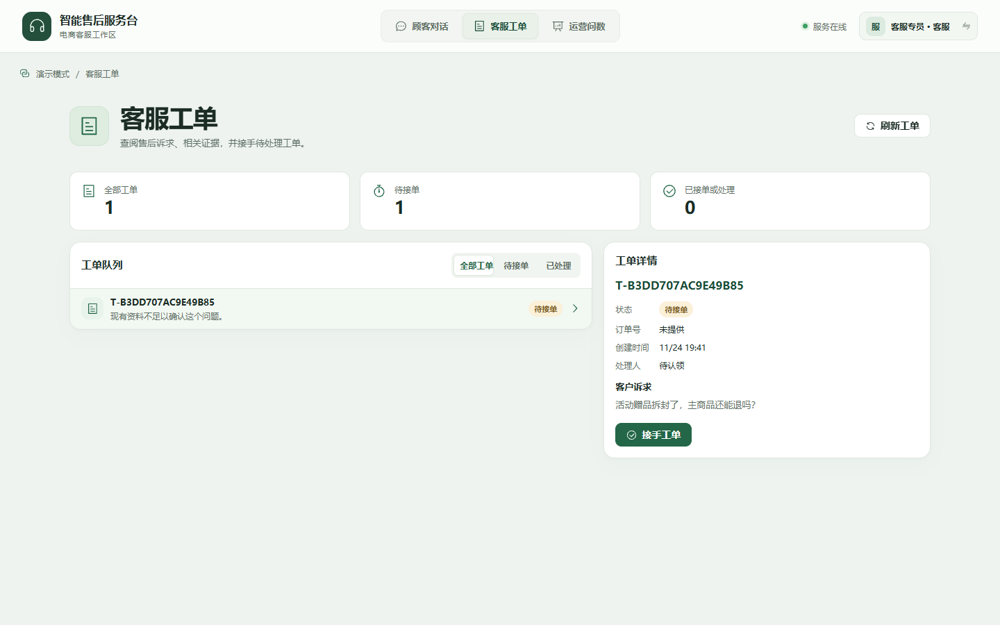

<p align="center">
  
</p>

<h1 align="center">电商智能客服系统</h1>

<p align="center">在同一套工作台里完成售后问答、人工工单和运营查询。</p>

在线体验支持输入问题并查看样例售后条款。完整对话、订单查询和工单可以在本地工作台体验。 [静态政策问答](https://ifox-hu.github.io/ecommerce-support/) · [本地启动](#3-快速开始)

<p align="center">
  
  
  
  
  <a href="https://github.com/ifox-hu/ecommerce-support/actions/workflows/quality.yml"></a>
</p>

<p align="center">
  <a href="#1-功能模块">功能模块</a> ·
  <a href="#5-界面预览">界面预览</a> ·
  <a href="#4-本地演示">本地演示</a> ·
  <a href="#3-快速开始">快速开始</a> ·
  <a href="#8-开发文档">开发文档</a>
</p>

## 1. 功能模块

系统用 LangGraph 管理客服流程。订单查询和工单创建由工作流调用 MCP 工具，政策问答依据检索到的条款生成回复，复杂售后问题可以生成分析摘要供客服接手。

| 工作区 | 使用者 | 主要功能 |
| --- | --- | --- |
| 顾客对话 | 顾客 | 流式对话、会话历史、订单与售后查询、条款引用、转人工与反馈 |
| 客服工单 | 客服 | 查看工单、核对订单和引用资料、接单与复核反馈 |
| 运营问数 | 运营 | 自然语言查询、指标口径、只读 SQL、执行计划和结构化结果 |

## 2. 技术架构

| 层级 | 实现 |
| --- | --- |
| 工作台与接口 | Vue 3、Element Plus、FastAPI，使用 SSE 推送客服运行事件和回复 |
| 客服编排 | LangGraph、固定路由规则、意图概率阈值、SQLite Checkpointer、MCP 子进程 |
| 政策检索 | BM25、向量召回、RRF、重排与证据判定。完整模式可接入 Milvus、BGE-M3、BGE-Reranker 和 Jev |
| 会话与业务数据 | 按用户和会话隔离，使用近期消息、分段摘要和已核实事实。演示模式使用 SQLite，完整模式接入 Redis List 与 MySQL |
| 运营问数 | LangGraph、jieba TF-IDF、候选指标检索、SQLGlot 校验、只读查询和 EXPLAIN |
| 可观测与评测 | OpenTelemetry、Jaeger、Prometheus、Grafana、可选 Langfuse，以及 GitHub Actions 回归 |

```text
顾客对话 → FastAPI / SSE → LangGraph 意图路由
  ├─ 订单、物流、退款 → MCP 查询 → 更新订单事实
  ├─ 售后政策 → 向量与 BM25 召回 → RRF 与重排 → 证据判定
  │    ├─ 证据充分 → 带引用的回答
  │    └─ 证据不足 → 补检索 → 仍不足时说明原因并创建人工工单
  ├─ 复杂售后 → 查询订单 → 分析摘要 → MCP 创建工单
  └─ 普通问题 → 通用模型回答

运营问数 → TF-IDF 与查询扩展 → 候选召回与排序 → SQL 生成
         → 校验与 EXPLAIN → 只读执行 → 结果与指标口径
         ↳ 可修复错误返回 SQL 生成节点，达到重试上限后停止
```

## 3. 快速开始

### 静态政策问答

静态页在浏览器里检索样例条款，显示适用渠道、版本和生效日期。资料不足时会说明缺口。它和本地工作台共享 `data/policies.json` 及主题词，访问时无需后端或模型密钥。

```powershell
npm --prefix frontend ci
npm --prefix frontend run build:pages
npm --prefix frontend run preview:pages
```

本地预览地址为 [127.0.0.1:4173](http://127.0.0.1:4173/)。发布到 GitHub Pages 时，在仓库 **Settings → Pages → Source** 选择 **GitHub Actions**，然后运行 **Static policy preview** 工作流。

### 本地工作台

在 Windows PowerShell 中进入项目目录，准备 Python 3.11+ 和 Node 22+ 后运行：

```powershell
.\start-demo.ps1
```

访问 [本地工作台](http://127.0.0.1:8765/)。端口被占用时执行 `.\start-demo.ps1 -Port 8780`。也可通过 `docker compose up --build app` 启动。浏览器端通过同源 `/api` 访问应用，本地开发可在 `frontend/` 执行 `npm run dev` 使用 Vite 代理。

默认 `demo` 模式使用预置合成数据、SQLite、实际 LangGraph 检查点及实际 MCP 子进程。售后意图、证据判断、语义召回和重排默认使用内置实现，BM25 与 RRF 在服务端计算。通用问答可使用本地模型。Redis、MySQL、Milvus 和 BGE-M3 可以分别通过配置接入。`full` 模式对接实际 TypeSafe Jev、聊天模型、Milvus、BGE-M3 与 BGE-Reranker，数据库使用 Redis 和 MySQL。

演示模式的通用问答默认使用本地 Ollama。启动 Ollama 后可用 `ollama pull deepseek-r1:7b` 安装默认模型，或通过 `ECOMMERCE_GENERAL_MODEL` 指定已安装的聊天模型。应用默认连接 `http://127.0.0.1:11434`。若后端在 Docker 中且 Ollama 在宿主机，可将 `ECOMMERCE_GENERAL_MODEL_URL` 设为 `http://host.docker.internal:11434`。

也可在 `.env` 将 `ECOMMERCE_GENERAL_MODEL_PROVIDER` 设为 `openai`，填入服务商的 API Base URL（通常以 `/v1` 结尾）、模型 ID 和 API Key，然后重启后端。配置项见 `.env.example`。应用会调用 Base URL 下的 `/chat/completions`，请求包含本轮问题和最近最多四条会话消息。商城查询和有依据的演示政策回答可独立使用。

## 4. 本地演示

[观看本地工作台录屏](docs/assets/previews/local-demo.webm)可查看政策引用、MCP 物流查询和证据不足后的人工工单。

| 用户 | 操作 | 预期 |
| --- | --- | --- |
| 顾客 Alice | 问「普通商品七天无理由退货需要什么条件？」 | 展开证据，查看 `P-RETURN` 条款和版本。 |
| 顾客 Alice | 问「订单 ORD-1001 的物流到哪了？」 | 查询 MCP 返回的运输状态和运单。切换 Bob，查询同一订单时看不到 Alice 的数据。 |
| 顾客 Alice | 问「活动赠品拆封了，主商品还能退吗？」 | 先收到缺少依据的提示，再收到人工工单。 |
| 顾客 Alice | 问「帮我写一封简短的请假邮件」 | 由通用问答模型直接给出邮件正文。 |
| 顾客 Alice | 问「劳动合同里的竞业限制在什么条件下有效？」 | 当前知识库缺少适用资料时，先提示检索结果，再提供通用参考。 |
| 客服 | 打开工单并点击接单 | 接单状态写入数据库，顾客可在工单列表查看。 |
| 运营 | 问「上周华东渠道各品类退款率是多少？」 | 查看按品类的结果、业务口径、SQL 和校验记录。运营夹具将日期固定为 2026-11-24，一周按周一至周日计算。 |

故障注入只在演示模式显式开启。以 `$env:ECOMMERCE_ENABLE_FAULTS='1'` 启动后，给 `POST /api/chat/stream` 增加 `X-Demo-Fault: after_ticket` 和请求 `请转人工`。流会返回已持久化的 `run_id` 和中断事件。停止当前进程、用同一数据目录重新启动，向 `POST /api/runs/{run_id}/resume` 发起请求，检查相同账号的 `GET /api/tickets` 中只有一条对应工单。API 支持 `demo-alice`、`demo-bob`、`demo-support`、`demo-ops` Bearer 令牌。`model` 可演示转人工兜底，`mcp` 可演示工具恢复后继续同一次执行。

可用 `.\.venv\Scripts\python.exe deployment/check_recovery.py` 自动启动隔离的临时进程，模拟工单写入后崩溃并核对恢复后的工单数。

## 5. 界面预览

以下截图取自本地演示模式，使用合成订单和政策数据。

### 顾客对话

七天无理由退货问答显示实际引用条款，右侧可展开检索过程和处理路由。


### 客服工单

售后政策证据不足时创建待接单工单，客服可以查看原始诉求并接手处理。



### 运营问数

按品类展示退款率，同时给出统计口径、实际执行的 SQL 和校验过程。


<details>
<summary>移动端顾客对话</summary>


</details>

## 6. 连接实际依赖

1. 通过 `docker compose --profile storage up -d redis mysql milvus` 启动隔离的数据服务，检查 `docker compose --profile storage ps`。宿主机默认端口为 Redis `26379`、MySQL `23306`、Milvus `29530`。MySQL 初始化脚本写入电商交易库和分析库，并为分析查询创建只读账号。配置文件里演示用的账号仅供本地实例。
2. 将 `.env.example` 复制成 `.env`，设置 `ECOMMERCE_MODE=full`，填写配置中对应的存储地址、聊天模型、Jev 密钥、BGE-Reranker 地址及自定义角色令牌。完整模式使用浏览器中输入的令牌。Docker 中运行后端时，MySQL、Redis、Milvus 地址使用 Compose 服务名和容器端口，宿主机 Ollama 使用 `host.docker.internal`。
3. Ollama 的 `/api/embed` 使用 `bge-m3`。重排服务使用兼容 Hugging Face TEI 的 `/rerank`，输入 `{query,texts}`，输出各文本的 `index` 与重排分数。可使用 `BAAI/bge-reranker-v2-m3`。提供了 `ECOMMERCE_RERANKER_KEY` 用于受认证的地址。
4. 在虚拟环境执行 `python -m pip install -e '.[test,integrations]'`，启动后端。首条知识问答会向量化并索引生效的 `data/policies.json`；自定义片段可用 `ECOMMERCE_KNOWLEDGE_FILE` 指定。政策 JSON 可通过生效日期更新版本，调用链路会返回两路召回、精排和证据判定记录。

## 7. 可观测与离线评测

后端在 `/metrics` 输出请求、路由、工具调用、模型耗时和 Token 指标。OpenTelemetry 记录 API、工作流节点、MCP 和数据库调用。Grafana 读取 Prometheus 指标，Jaeger 查看单次运行的链路。配置 Langfuse 后，可记录模型调用和用量，并关联 Judge 评分。[运行观测配置](deployment/observability/README.md)

观测启动命令为 `docker compose -f deployment/observability/compose.yml up -d --build`。本地应用设置 `ECOMMERCE_OTEL_ENDPOINT=http://127.0.0.1:4318`。Prometheus 默认抓取宿主机 `8765`，Docker Desktop 下宿主机应用用于抓取时需使用 `--host 0.0.0.0`。[Grafana](http://127.0.0.1:3001/) · [Prometheus](http://127.0.0.1:9090/) · [Jaeger](http://127.0.0.1:16686/)

```powershell
.\.venv\Scripts\python.exe -m pytest -q
npm.cmd --prefix frontend test
.\.venv\Scripts\python.exe -m evals.run --profile all --faults --require-mode demo --output .runtime/eval-demo.json
```

离线评测包含 1,200 条合成样例，覆盖意图、检索、工作流、长对话、问数和故障隔离。可复跑向量召回、混合召回、重排，以及近期消息与分层记忆的对照实验。GitHub Actions 执行本地依赖下的冒烟回归与前端构建，完整依赖与 Judge 评测由手动任务触发并依赖环境配置。[评测方法](evals/README.md) · [回归工作流](.github/workflows/quality.yml)

反馈示例使用 `python -m evals.feedback_case prepare --output .runtime/policies-candidate.json` 从基础知识库生成候选条款，用独立进程加载候选文件，然后运行 `python -m evals.feedback_case replay --baseline-url http://127.0.0.1:8765 --candidate-url http://127.0.0.1:8766 --output .runtime/feedback-replay.json`。回放会提交并复核测试反馈、复验更新后的引用和路由。

## 8. 开发文档

[OpenAPI 交互文档](http://127.0.0.1:8765/docs) · [离线评测](evals/README.md) · [运行观测](deployment/observability/README.md) · [AIOps 架构参考](https://github.com/ifox-hu/aiops-py)

| 方法与路径 | 用途 |
| --- | --- |
| `GET /api/health`、`GET /metrics` | 服务健康与 Prometheus 指标 |
| `POST /api/chat/stream` | 发起客服对话并接收 SSE 事件 |
| `POST /api/runs/{run_id}/resume` | 从检查点恢复中断的执行 |
| `GET /api/sessions`、`GET /api/sessions/{session_id}/messages` | 会话列表与分页历史 |
| `GET /api/tickets`、`POST /api/tickets/{ticket_id}/claim` | 查询工单与客服接单 |
| `POST /api/analytics` | 运行运营问数流程 |
| `POST /api/feedback`、`GET /api/feedback`、`PATCH /api/feedback/{identifier}` | 提交、查看与复核反馈 |

## 9. 项目结构

| 目录 | 职责 |
| --- | --- |
| `app/api` | HTTP 接口、SSE、角色校验和请求模型 |
| `app/agent` | LangGraph 客服节点和固定路由 |
| `app/mcp` | MCP 客户端、独立工具进程和订单访问边界 |
| `app/services` | 订单、工单、检索、会话、执行记录和模型调用 |
| `app/services/analytics` | 问数图、指标目录、SQL 校验与只读查询 |
| `app/core` | 指标、链路和模型跟踪 |
| `frontend/src/views` | 顾客对话、客服工单和运营问数页面 |
| `data`、`evals`、`tests` | 合成数据、评测集与回归用例 |
| `deployment` | 容器与可观测配置 |
| `docs/assets` | README 横幅和演示截图 |

## 10. 数据与验证边界

- 演示数据为合成样例，包含订单、物流、售后政策和运营数据。演示模式可验证工作流、MCP、检查点和数据库写入，模型相关实现以当前运行配置为准。
- 完整模式需要配置实际模型、Jev、检索服务和数据服务。实验报告通过 `runtime.mode`、模型及知识版本标记测试环境。
- 评测中的记忆指标是指定样例上的订单引用保留率。检索与记忆对照结果应与样本数、基线和运行模式一起引用。
