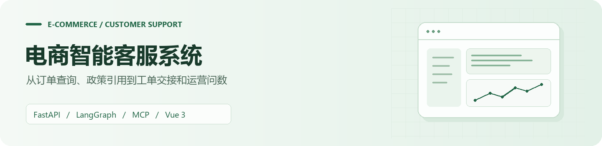
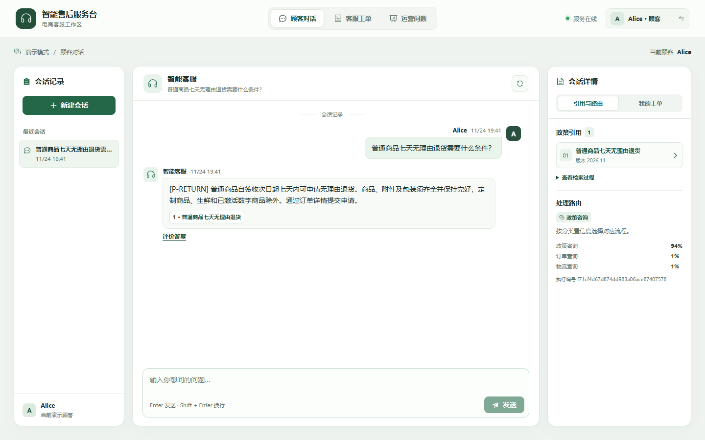
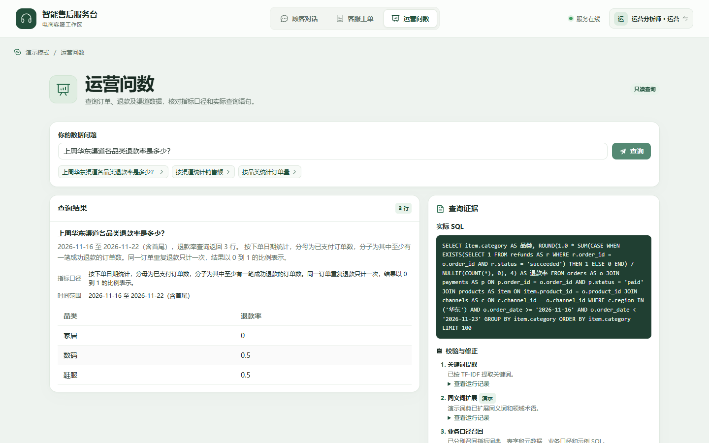
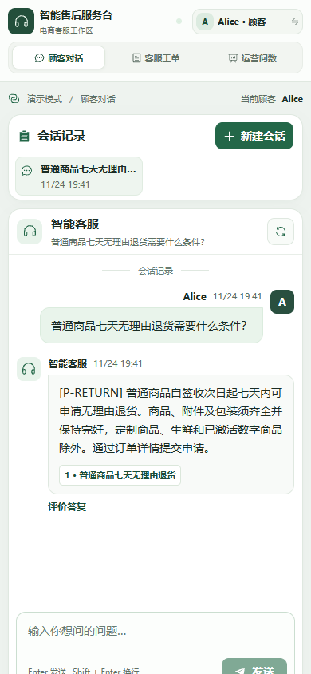

<div align="center">
  

  <h1>电商智能客服系统</h1>
  <p>顾客查订单和退货政策，客服接工单，运营查订单量和退款率。</p>

  
  
  
  
  <a href="https://github.com/ifox-hu/ecommerce-support/actions/workflows/quality.yml"></a>

  <p>
    <a href="https://ifox-hu.github.io/ecommerce-support/">在线演示</a> ·
    <a href="#功能模块">功能模块</a> ·
    <a href="#界面预览">界面预览</a> ·
    <a href="#快速开始">快速开始</a> ·
    <a href="#项目文档">项目文档</a> ·
    <a href="https://github.com/ifox-hu/aiops-py">上游项目</a>
  </p>
</div>

## 项目介绍

这是一个面向电商售后的个人项目，包含顾客对话、客服工单和运营问数三个页面。

开发时重点处理了三件事：售后回答附上具体条款，工单写入后即使服务中断也能恢复，运营查询能看到实际执行的 SQL 和指标口径。

## 在线演示

| 体验方式 | 入口 | 可以做什么 |
| --- | --- | --- |
| **在线工作台** | [顾客对话](https://ifox-hu.github.io/ecommerce-support/#customer) · [客服工单](https://ifox-hu.github.io/ecommerce-support/#support) · [运营问数](https://ifox-hu.github.io/ecommerce-support/#analytics) | 查询样例政策和订单，创建并接手演示工单，查看示例问数结果 |
| **完整工作台录屏** | [观看录屏](docs/assets/previews/local-demo.webm) | 查看政策引用、订单物流查询和转人工建单 |
| **本地工作台** | [启动步骤](#快速开始) | 在顾客、客服和运营身份之间切换，操作订单查询、工单和问数 |

先在顾客对话输入「退款一般多久到账？」查看条款。再问「活动赠品拆封了，主商品还能退吗？」，切到客服工单接手。最后到运营问数选择「上周华东渠道各品类退款率是多少？」查看样例结果和 SQL。

在线工作台使用合成数据，无需登录或启动后端。会话、工单和反馈保存在当前浏览器，运营问数展示预先计算的样例。连接真实服务和运行完整问数流程可使用本地工作台。

## 功能模块

| 模块 | 已有能力 | 对应源码 |
| --- | --- | --- |
| **顾客对话** | 查询订单、物流和售后进度，查看会话历史和引用的售后条款 | [顾客页面](frontend/src/views/ChatView.vue) · [客服流程](app/agent/workflow.py) |
| **客服工单** | 查看顾客诉求和已核实的订单信息，领取待处理工单，复核顾客反馈 | [客服页面](frontend/src/views/SupportView.vue) · [业务服务](app/services/business.py) |
| **运营问数** | 用自然语言查询订单量、销售额和退款率，查看统计口径、实际 SQL 与校验记录 | [运营页面](frontend/src/views/AnalyticsView.vue) · [问数服务](app/services/analytics) |

### 开发重点

- **政策回答附出处**。后端将 BM25 和向量召回结果用 RRF 合并，再做重排和证据检查。符合适用条件时给出条款，证据不足时补检索，仍无法确认就转人工。
- **中断后恢复处理**。LangGraph Checkpointer 保存执行进度，订单查询和建单由 MCP 提供。在工单写入后重启服务并恢复执行，工单只保留一份。
- **会话按用户隔离**。每段会话保留近期消息、历史摘要和已核实的订单信息。演示使用 SQLite，完整模式可用 Redis List 存储会话。
- **问数查询可核对**。按问题匹配指标和字段，生成 SQL，校验后执行 EXPLAIN 与只读查询。能修正的 SQL 错误会交回生成节点重试。

## 界面预览

以下截图来自本地工作台。点击图片可查看原图。

| 顾客对话 · 政策引用 | 客服工单 · 待接单 | 运营问数 · 退款率 |
| --- | --- | --- |
| [](docs/assets/previews/customer-1440.png) | [](docs/assets/previews/support-1440.png) | [](docs/assets/previews/analytics-1440.png) |

<details>
<summary>移动端顾客对话</summary>



</details>

<a name="3-快速开始"></a>
<a name="1-快速开始"></a>

## 快速开始

Windows 安装 Python 3.11+ 和 Node.js 22+ 后，在 PowerShell 运行。

```powershell
git clone https://github.com/ifox-hu/ecommerce-support.git
cd ecommerce-support
.\start-demo.ps1
```

打开 [本地工作台](http://127.0.0.1:8765/)。端口被占用时运行 `.\start-demo.ps1 -Port 8780`。也可以直接用 `docker compose up --build app` 启动。

| 身份 | 可以试的问题或操作 |
| --- | --- |
| 顾客 Alice | 「订单 ORD-1001 的物流到哪了？」切换到 Bob 再查同一订单，可体验账号隔离 |
| 客服专员 | 顾客提出缺少依据的售后问题后，打开「客服工单」并接手 |
| 运营分析师 | 「上周华东渠道各品类退款率是多少？」查看结果表格和右侧 SQL |

<details>
<summary>通用问答与完整模式配置</summary>

默认演示模式用 SQLite 和内置样例。查订单、政策和工单无需模型密钥。日常问题默认由本机 Ollama 上的 `deepseek-r1:7b` 回答，可在 `ECOMMERCE_GENERAL_MODEL` 指定其他模型。

使用 OpenAI 兼容服务时，在本地 `.env` 中将 `ECOMMERCE_GENERAL_MODEL_PROVIDER` 设为 `openai`，填写模型地址、名称和密钥后重启。应用会将本轮问题及最近最多四条消息发给该服务。[配置模板](.env.example)

完整模式可连接 Redis、MySQL、Milvus、BGE-M3、BGE-Reranker 和 TypeSafe Jev。先运行 `docker compose --profile storage up -d redis mysql milvus`，再根据 [配置模板](.env.example) 填写连接与模型设置，将 `ECOMMERCE_MODE` 设为 `full`，并安装 `python -m pip install -e '.[integrations]'`。如果应用也在 Docker 中，存储地址使用 Compose 服务名，宿主机模型地址使用 `host.docker.internal`。

</details>

## 技术架构

| 层次 | 技术 |
| --- | --- |
| 工作台与接口 | Vue 3、Element Plus、FastAPI、SSE |
| 客服编排与工具 | LangGraph、SQLite Checkpointer、MCP |
| 检索与存储 | BM25、RRF、SQLite，可配置 Milvus、Redis、MySQL、BGE-M3 与 BGE-Reranker |
| 问数 | jieba TF-IDF、SQLGlot、只读 SQL 与 EXPLAIN |
| 观测与评测 | OpenTelemetry、Jaeger、Prometheus、Grafana、可选 Langfuse、GitHub Actions |

```text
app/api/                HTTP 接口、角色校验和请求模型
app/agent/              客服流程与意图路由
app/mcp/                工具客户端和订单、工单工具
app/services/           检索、业务、会话、执行记录和模型调用
app/services/analytics/ 问数流程、指标目录和 SQL 校验
frontend/src/views/     顾客、客服、运营三个页面
frontend/preview/       GitHub Pages 演示数据和浏览器端服务
data/                   示例政策和业务数据
evals/                  离线评测和反馈回放
deployment/             部署配置和恢复检查
```

## 项目文档

| 文档 | 说明 |
| --- | --- |
| [OpenAPI](http://127.0.0.1:8765/docs) | 本地启动后可调试对话、工单和问数接口 |
| [离线评测](evals/README.md) | 1,200 条合成样例、对照实验、Judge 配置与反馈回放 |
| [运行观测](deployment/observability/README.md) | 启动 Prometheus、Grafana 和 Jaeger，查看指标和链路 |
| [工单恢复检查](deployment/check_recovery.py) | 工单写入后中断并重启，验证恢复与去重 |
| [GitHub Actions](.github/workflows/quality.yml) | 回归检查与可选的完整模式评测 |

<details>
<summary>本地预览静态工作台</summary>

```powershell
npm --prefix frontend ci
npm --prefix frontend run build:pages
npm --prefix frontend run preview:pages
```

打开 [127.0.0.1:4173](http://127.0.0.1:4173/)。线上版本由 [Pages 工作流](.github/workflows/pages.yml) 发布。

</details>
